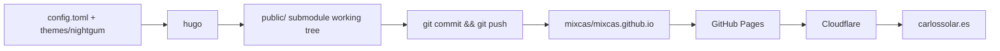

# carlossolar.es

Personal site of Carlos Solares — a Hugo static site deployed to GitHub Pages at
https://carlossolar.es/.

> **Status:** The live site is served from the `public/` submodule
> (`mixcas/mixcas.github.io`), whose `index.html`, `style.css`, and other assets have been
> hand-edited since 2016 and do **not** match what Hugo generates from this repo. Running
> `deploy.sh` (or a bare `hugo`) overwrites those edits with theme output and then, unmodified,
> aborts: it pushes a branch that does not exist.

## Stack

| Layer | Technology |
|---|---|
| Static site generator | Hugo (Go), TOML config, no JS toolchain, no package manager |
| Theme | `nightgum` — vendored in-repo under `themes/nightgum/`, MIT, derived from the Jekyll theme *Heather* |
| Content | Markdown with TOML front matter; **currently zero content files** |
| Styling | One hand-written stylesheet + a self-hosted WOFF font (Linux Libertine) |
| Build output | `public/` — a git submodule pointing at `mixcas/mixcas.github.io` |
| Hosting | GitHub Pages (serves `mixcas.github.io`) |
| DNS / CDN | Cloudflare in front of GitHub Pages (`CNAME` file contains `carlossolar.es`) |
| Deploy | `deploy.sh` — build, then commit and push the `public` submodule |

## Repository layout

```text
.
├── .gitignore          # ignores .hugo_build.lock and resources/
├── .gitmodules         # submodule definition (public only)
├── archetypes/
│   └── default.md      # TOML front matter template used by `hugo new`
├── config.toml         # site config (baseurl, locale, title, theme, [params])
├── deploy.sh           # build + commit + push the public/ submodule
├── public/             # SUBMODULE → mixcas/mixcas.github.io (the published site)
└── themes/
    └── nightgum/       # the theme, tracked directly in this repo
```

There is **no `content/` directory** and **no root `layouts/`**; all templates resolve from
`themes/nightgum/`. `hugo new content …` refuses to run until a `content/` directory exists.

The theme is **not** a submodule: its files are committed here, so `git clone` alone is enough to
build (no `--recurse-submodules` needed). It was migrated off the removed `.Site.Author` /
deprecated `.Site.LanguageCode` APIs — see [Hugo version compatibility](#hugo-version-compatibility).

Theme files (`themes/nightgum/`):

| Path | Purpose |
|---|---|
| `layouts/index.html` | Home template: `head` + `description` partials, `<main class="home section">`, `{{ range site.RegularPages }}` |
| `layouts/404.html` | Not-found page |
| `layouts/_default/single.html` | Single page template |
| `layouts/_default/list.html` | List template for `section`, `taxonomy`, and `term` kinds (`tags/`, `categories/`, post sections) |
| `layouts/partials/head.html` | `<head>`, `<html lang>`, author and description meta tags, stylesheet link |
| `layouts/partials/description.html` | Renders `[params] description` through `safeHTML` |
| `layouts/partials/foot.html` | Closing `</footer></body></html>` |
| `layouts/shortcodes/gist.html` | `` shortcode |
| `layouts/shortcodes/youtube.html` | `` shortcode |
| `static/style.css` | Site stylesheet (104 lines, Heather-derived) |
| `static/fonts/LinLibertine_DR.woff` | Self-hosted Linux Libertine font |
| `static/favicon.png`, `static/apple-touch-icon.png` | Icons |
| `theme.toml` | Theme metadata (`min_version = 0.13`, stale) |
| `README.md`, `archetypes/default.md` | Both **empty (0 bytes)** |

## How it works



- Hugo writes the built site **directly into the `public/` submodule's working tree**
  (`publishDir` defaults to `public`), so a plain `hugo` or `hugo server` mutates a tracked
  submodule. Pass `--destination` (or `-d`) to build somewhere else.
- `themes/nightgum` is now a normal directory in this repo: edit templates and stylesheets here,
  in place. No submodule pointer to bump.
- The output now committed in `public/` does **not** match this repo's output — see
  [Known issues](#known-issues--gotchas).

## Requirements

- **Hugo v0.158.0 or newer** (`site.Language.Locale` and the `locale` config key require it).
  Verified working with the current `brew` release, **v0.167.0**.
- Git, with SSH access to `mixcas/carlossolar-es` and `mixcas/mixcas.github.io`.
- Docker, if using the container route (optional).

## Getting started

```bash
git clone git@github.com:mixcas/carlossolar-es.git
cd carlossolar-es
git submodule update --init public    # only needed to build into/publish via public/
```

The theme is committed in-repo, so no submodule is required to build — only `public/` is a
submodule, and it matters for deploying.

### Installing Hugo

`brew install hugo` installs the current release (0.167.0 as of writing), which builds this
theme cleanly:

```bash
brew install hugo
hugo version   # expect: hugo v0.167.0+extended ... darwin/arm64
```

Docker (any supported version, no local install):

```bash
docker run --rm -it -v "$PWD":/project -p 1313:1313 \
  ghcr.io/gohugoio/hugo:v0.167.0 server --bind 0.0.0.0
```

The image's working directory is `/project`, it runs as uid 1000, and `--bind 0.0.0.0` is what
makes the port reachable from the host.

On macOS, Docker Desktop only shares some host paths by default. Mounting an unshared directory
(e.g. under `/private/tmp`) succeeds but appears **empty** inside the container, and Hugo then
fails with `Unable to locate config file or config directory`. Keep the clone under `$HOME`.

## Develop

- `hugo server` → http://localhost:1313/ (defaults: port 1313, bind 127.0.0.1). Add
  `-D`/`--buildDrafts` to include drafts, `--disableFastRender` for exact rebuilds. Live reload
  works. A `content/` directory must exist first if new pages are to be authored.
- **`hugo`/`hugo server` write into `public/` by default** (see [Build](#build)), dirtying the
  submodule. For a preview that leaves `public/` alone, use
  `hugo server -d /tmp/hugo-preview` or the Docker command above (which also builds in place, so
  prefer `-d` there too if you care about the working tree).
- Editing the home page means editing `themes/nightgum/layouts/index.html` (markup) and
  `config.toml` `[params] description` (the text). The live `public/index.html` was instead
  hand-edited and has diverged; rebuilding replaces it.

## Build

```bash
hugo            # writes to ./public (Hugo's default publishDir)
hugo --minify   # optional
hugo -d /tmp/out   # build elsewhere, leaving public/ untouched
```

There are **no `content/` files**, so the build reports `Pages 8` and emits: the home page,
`404.html`, `sitemap.xml`, `index.xml` (RSS), and empty `tags/index.html` +
`categories/index.html` taxonomy list pages (each also gets an `index.xml`), plus a copy of
`themes/nightgum/static/*` (`style.css`, `favicon.png`, `apple-touch-icon.png`,
`fonts/LinLibertine_DR.woff`). The build is clean — no warnings or deprecations.

With content added, `_default/list.html` and `_default/single.html` render sections, taxonomy
terms, and individual posts.

`.hugo_build.lock` is created in the project root during builds and is git-ignored; it is safe to
delete.

## Deploy

```bash
./deploy.sh                 # commit message: "rebuilding site <date>"
./deploy.sh "my message"    # commit message: "my message"
```

Manual equivalent:

```bash
hugo
cd public
git add -A
git commit -m "rebuilding site $(date)"
git push origin main        # NOTE: deploy.sh still says `master` — see Known issues
cd ..
```

> **WARNING:** `hugo` regenerates `public/index.html`, `public/style.css`, and the rest of the
> built site from the theme, **destroying** the hand-edited home page that the live site currently
> serves. The unmodified `deploy.sh` also pushes `origin master` inside `public/`, but that repo's
> default branch is `main` and it has no `master` branch, so the push aborts.

The parent repo must be pushed separately (`git push origin master`) — `deploy.sh` only touches
the `public` submodule.

## Known issues & gotchas

1. **`deploy.sh` pushes a non-existent branch.** `git push origin master` inside `public/` fails
   with `src refspec master does not match any`; the live branch is `main`. Fix: change that line
   to `git push origin main` (or `git push origin HEAD:main`).
2. **The committed output no longer matches this repo.** `public/` `main` holds hand-edited
   output; a rebuild replaces `index.html`, `404.html`, `index.xml`, and `sitemap.xml`, and adds
   `tags/` + `categories/`. Do not run `deploy.sh` expecting the live page to survive.
3. **The live page is hand-edited.** `public` `main` contains the Korean subtitle, OG tags, the
   Ensenada/Mexico City bio, Videate and CV links, and a `.container { max-width: 700px; }` rule.
   Rebuilding would silently remove all of it.
4. **`baseurl` uses `http://` and is lowercase.** Lowercase is fine (Hugo lowercases config keys
   internally) but is non-idiomatic; `baseURL` with `https://` is correct for a
   Cloudflare-fronted HTTPS site.
5. **`archetypes/default.md` has no `title`/`date`.** `hugo new content` output would need both
   filled in manually.
6. **No `content/` directory exists**, so `hugo new content post.md` fails with
   `no existing content directory configured for this project` until `content/` is created.

## Hugo version compatibility

The theme was migrated for Hugo v0.158.0+; minimum supported version is **v0.158.0** (verified —
v0.156.0 fails because `site.Language.Locale` does not exist yet).

| API / key | Before | Now (in this repo) | Why |
|---|---|---|---|
| `.Site.Author` | `head.html:6` | `site.Params.author.name` | Removed in Hugo v0.156.0 (hard build error) |
| `.Site.LanguageCode` | `head.html:2` | `site.Language.Locale` | Deprecated v0.158.0, removed later |
| `languageCode` (config) | `config.toml:2` | `locale` | Deprecated v0.158.0 |
| `.Data.Pages` | `index.html:5` | `site.RegularPages` | Legacy API; also lists only regular pages, not section/taxonomy nodes |
| date layout | `index.html`, `single.html` | `2006-01-02` / `Jan 02, 2006` | The old `01`/`30` tokens are Go's *month*, producing crooked dates |

`params.author.name` is read from `config.toml`:

```toml
[params]
  author.name = "Carlos Solares"
```

Because the templates are committed in this repo, upgrading Hugo only requires editing
`themes/nightgum/layouts/*` here — no submodule bump, no separate theme repo.

## License

- Theme `nightgum`: MIT (`themes/nightgum/LICENSE.md`), derived from the Jekyll theme *Heather*.
- No root `LICENSE` file exists; the site content and config are personal and unlicensed.
