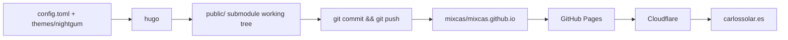

# carlossolar.es

Personal site of Carlos Solares — a Hugo static site deployed to GitHub Pages at
https://carlossolar.es/.

> **Status:** The live site is served from the `public/` submodule
> (`mixcas/mixcas.github.io`), whose `index.html` and `style.css` have been hand-edited since
> 2016 and do **not** match what Hugo generates from this repo. Running the current `deploy.sh`
> overwrites those edits with theme output and then aborts, because it pushes a branch that does
> not exist.

## Stack

| Layer | Technology |
|---|---|
| Static site generator | Hugo (Go), TOML config, no JS toolchain, no package manager |
| Theme | `nightgum` — local git submodule `mixcas/nightgum`, MIT, derived from the Jekyll theme *Heather* |
| Content | Markdown with TOML front matter; **currently zero content files** |
| Styling | One hand-written stylesheet + a self-hosted WOFF font (Linux Libertine) |
| Build output | `public/` — a git submodule pointing at `mixcas/mixcas.github.io` |
| Hosting | GitHub Pages (serves `mixcas.github.io`) |
| DNS / CDN | Cloudflare in front of GitHub Pages (`CNAME` file contains `carlossolar.es`) |
| Deploy | `deploy.sh` — build, then commit and push the `public` submodule |

## Repository layout

```text
.
├── archetypes/
│   └── default.md      # TOML front matter template used by `hugo new`
├── config.toml         # site config (baseurl, languageCode, title, theme, [params])
├── deploy.sh           # build + commit + push the public/ submodule
├── .gitmodules         # submodule definitions (themes/nightgum, public)
├── public/             # SUBMODULE → mixcas/mixcas.github.io (the published site)
└── themes/
    └── nightgum/       # SUBMODULE → mixcas/nightgum (layouts + static assets)
```

There is **no `content/` directory** and **no root `layouts/`**; all templates resolve from
`themes/nightgum/`. `hugo new content …` refuses to run until a `content/` directory exists.

Theme files (`themes/nightgum/`):

| Path | Purpose |
|---|---|
| `layouts/index.html` | Home template: `head` + `description` partials, `<main class="home section">`, `{{ range .Data.Pages }}` |
| `layouts/404.html` | Not-found page |
| `layouts/_default/single.html` | Single page template (unused — no content) |
| `layouts/partials/head.html` | `<head>`, `<html lang>`, author and description meta tags, stylesheet link |
| `layouts/partials/description.html` | Renders `[params] description` through `safeHTML` |
| `layouts/partials/foot.html` | Closing `</footer></body></html>` |
| `layouts/shortcodes/gist.html` | `` shortcode |
| `layouts/shortcodes/youtube.html` | `` shortcode |
| `static/style.css` | Site stylesheet (100 lines, Heather-derived) |
| `static/fonts/LinLibertine_DR.woff` | Self-hosted Linux Libertine font |
| `static/favicon.png`, `static/apple-touch-icon.png` | Icons |
| `theme.toml` | Theme metadata (`min_version = 0.13`, stale) |
| `README.md`, `archetypes/default.md` | Both **empty (0 bytes)** |

## How it works



- Hugo writes the built site **directly into the `public/` submodule's working tree**
  (`publishDir` defaults to `public`), so building mutates a tracked submodule.
- `themes/nightgum` is a separate repo: changes to templates and static assets belong there
  (or must be shadowed by a root `layouts/` directory), not in this repo.
- The submodule is **pinned at theme commit `b5cf0c5`**, but the output currently committed in
  `public/` was generated from the older `755aaf9` — the two are not in sync.

## Requirements

- **Hugo v0.155.3** — the newest release the pinned theme builds with (see
  [Hugo version compatibility](#hugo-version-compatibility)). Do **not** use
  `brew install hugo` (installs 0.167.0, which fails the build).
- Git, with SSH access to `mixcas/carlossolar-es`, `mixcas/nightgum`, and
  `mixcas/mixcas.github.io`.
- Docker, if using the container route (recommended; matches the setup this project was verified
  against).

## Getting started

```bash
git clone --recurse-submodules git@github.com:mixcas/carlossolar-es.git
cd carlossolar-es
# already cloned without --recurse-submodules?
git submodule update --init --recursive
```

### Hugo v0.155.3

Docker (preferred):

```bash
docker run --rm -it -v "$PWD":/project -p 1313:1313 \
  ghcr.io/gohugoio/hugo:v0.155.3 server --bind 0.0.0.0
```

The image's working directory is `/project`, it runs as uid 1000, and `--bind 0.0.0.0` is what
makes the port reachable from the host.

On macOS, Docker Desktop only shares some host paths by default. Mounting an unshared directory
(e.g. under `/private/tmp`) succeeds but appears **empty** inside the container, and Hugo then
fails with `Unable to locate config file or config directory`. Keep the clone under `$HOME`.

macOS installer, from the v0.155.3 release assets:

```bash
curl -LO https://github.com/gohugoio/hugo/releases/download/v0.155.3/hugo_extended_0.155.3_darwin-universal.pkg
sudo installer -pkg hugo_extended_0.155.3_darwin-universal.pkg -target /
hugo version   # expect: hugo v0.155.3+extended ...
```

(`hugo_0.155.3_darwin-universal.pkg` works too if the extended binary is not needed.)

## Develop

- `hugo server` → http://localhost:1313/ (defaults: port 1313, bind 127.0.0.1). Add
  `-D`/`--buildDrafts` to include drafts, `--disableFastRender` for exact rebuilds. Live reload
  works. A `content/` directory must exist first if new pages are to be authored.
- Preview inside Docker with the exact command from [Hugo v0.155.3](#hugo-v01553).
- Editing the home page means editing either `themes/nightgum/layouts/index.html` +
  `config.toml` `[params] description` (theme/config route, regenerated output), **or**
  `public/index.html` directly (the route actually used since 2016). The two have diverged and
  rebuilding takes the first route.

## Build

```bash
hugo            # writes to ./public (Hugo's default publishDir)
hugo --minify   # optional
```

There are **no `content/` files**, so with Hugo v0.155.3 the build reports `Pages 6` and emits:
the home page, `404.html`, `sitemap.xml`, `index.xml` (RSS), empty `tags/index.html` and
`categories/index.html` taxonomy list pages, plus a copy of `themes/nightgum/static/*`
(`style.css`, `favicon.png`, `apple-touch-icon.png`, `fonts/LinLibertine_DR.woff`). It also logs:

```text
WARN  found no layout file for "html" for kind "taxonomy": ...
```

That warning is expected: the theme ships no taxonomy list template and there is no content to
list. Disable the taxonomies in `config.toml` or add the template in the theme to silence it.

`.hugo_build.lock` is created in the project root during builds and is safe to delete.

## Deploy

```bash
./deploy.sh                 # commit message: "rebuilding site <date>"
./deploy.sh "my message"    # commit message: "my message"
```

Manual equivalent:

```bash
hugo
cd public
git add -A
git commit -m "rebuilding site $(date)"
git push origin main        # NOTE: deploy.sh still says `master` — see Known issues
cd ..
```

> **WARNING:** `hugo` regenerates `public/index.html` and `public/style.css` from the theme,
> **destroying** the hand-edited home page and stylesheet that the live site currently serves.
> The unmodified `deploy.sh` runs whatever `hugo` is on `PATH`; with Hugo ≥ 0.156 the build fails
> before it reaches the push (`.Site.Author` was removed). `deploy.sh` then pushes
> `origin master` inside `public/`, but that repo's default branch is `main` and it has no
> `master` branch, so the push aborts.

The parent repo must be pushed separately (`git push origin master`) — `deploy.sh` only touches
the `public` submodule.

## Known issues & gotchas

1. **`deploy.sh` pushes a non-existent branch.** `git push origin master` inside `public/` fails
   with `src refspec master does not match any`; the live branch is `main`. Fix: change that line
   to `git push origin main` (or `git push origin HEAD:main`).
2. **The committed output no longer matches the theme.** `public/` was generated from theme
   `755aaf9` while the submodule is pinned at `b5cf0c5`; `public/style.css` (101 lines) and
   `themes/nightgum/static/style.css` (100 lines) differ — the committed copy has `.home*`
   selectors and `.red`/`.yellow` rules, the theme copy has `.section`, `time`, and `ul.posts`.
3. **The live page is hand-edited.** `public` `main` contains the Korean subtitle, OG tags, the
   Ensenada/Mexico City bio, Videate and CV links, and a `.container { max-width: 700px; }` CSS
   rule that no template or stylesheet in this repo produces. Rebuilding would silently remove
   all of it.
4. **Hugo ≥ 0.156 cannot build this theme.** `.Site.Author` was removed
   (`themes/nightgum/layouts/partials/head.html:6`). Pin 0.155.3, or migrate (see next section).
5. **`baseurl` uses `http://` and is lowercase.** Lowercase is fine (Hugo lowercases config keys
   internally) but is non-idiomatic; `baseURL` with `https://` is correct for a
   Cloudflare-fronted HTTPS site.
6. **`archetypes/default.md` has no `title`/`date`.** `hugo new content` output would need both
   filled in manually.
7. **No `content/` directory exists**, so `hugo new content post.md` fails with
   `no existing content directory configured for this project` until `content/` is created.

## Hugo version compatibility

| API / key | Location | Status vs modern Hugo | Replacement |
|---|---|---|---|
| `.Site.Author` | `themes/nightgum/layouts/partials/head.html:6` | **Removed in v0.156.0** | `site.Params.author.name` |
| `.Site.LanguageCode` | `themes/nightgum/layouts/partials/head.html:2` | Deprecated in v0.158.0; WARN, build error after ~15 minors | `.Site.Language.Locale` |
| `languageCode` (config) | `config.toml:2` | Deprecated in v0.158.0 | `locale` |
| `.Data.Pages` | `themes/nightgum/layouts/index.html:5` | Legacy; still functional | `site.RegularPages` or `Pages` |
| `theme.toml` | `themes/nightgum/theme.toml` | Still read for theme metadata; `min_version = 0.13` is meaningless now | — |

Last known-good Hugo: **v0.155.3** (with this config, `Site.Author()` returns an empty map and
emits no deprecation log, so the build is clean). Current `brew` formula is 0.167.0, which fails
the build.

Migrating to current Hugo — **the fixes live in the theme repo**:

```bash
# inside themes/nightgum (or the mixcas/nightgum clone), edit layouts/partials/head.html:
#   {{ .Site.LanguageCode }}       → {{ .Site.Language.Locale }}
#   {{ .Site.Author.name }}        → {{ site.Params.author.name }}
# and config.toml:
#   languageCode = "es-MX"         → locale = "es-MX"
# and themes/nightgum/layouts/index.html:
#   {{ range .Data.Pages }}        → {{ range site.RegularPages }}
```

Because `head.html` lives in the submodule, either the change must be committed to
`mixcas/nightgum` and this repo's submodule pointer bumped, or the file must be shadowed by an
identical copy under a root `layouts/partials/head.html`.

## License

- Theme `nightgum`: MIT (`themes/nightgum/LICENSE.md`), derived from the Jekyll theme *Heather*.
- No root `LICENSE` file exists; the site content and config are personal and unlicensed.
